# fixer-frontend — Codebase Map

Route → page → components → libs → API endpoints → backend module, for the Next.js app. Generated from source on 2026-11-26 (commit `7f68b11`).
**Keep it current:** when you add a page, move a component or call a new endpoint, update the matching row here.

- All paths are relative to `app/`. Endpoints are relative to the API base (`…/api/v1`).
- Backend module names refer to `fixer-backend/src/<module>/`. See `fixer-backend/docs/CODEBASE_MAP.md` for the server side.
- API base: `config.ts` → `API_URL` (`NEXT_PUBLIC_API_URL`, default `http://127.0.0.1:8081/api/v1`, rewrites localhost to the page host for LAN testing).

---

## 1. App shell & shared state

| Concern | Files |
|---|---|
| Root layout | `layout.tsx` → `components/GoogleAuthProvider.tsx`, `context/AuthContext.tsx`, `context/BookingContext.tsx`, `components/BookingModal.tsx` |
| Auth state (customer + admin JWT) | `context/AuthContext.tsx` → `/auth/{login,quick-login,google,register,me}` (backend `auth`) |
| Booking modal state + pending booking | `context/BookingContext.tsx`, `lib/pending-booking.ts` (stores a draft booking across login) |
| Site chrome | `components/Navbar.tsx`, `components/MobileBottomNav.tsx`, `components/Footer.tsx`, `components/FixxerLogo.tsx`, `components/FloatingCallButton.tsx` |
| UI primitives (shadcn/radix) | `components/ui/{button,dialog,command,badge,input,separator,tooltip}.tsx`, `components/ConfirmActionDialog.tsx`, `lib/utils.ts` (`cn`) |
| Phone helpers | `lib/auth.ts` (`normalizePhone`, `isValidPhone`, mirrors backend `auth.service`) |
| Shop gating | `components/shop/ShopMaintenanceGate.tsx` + `ShopMaintenanceScreen.tsx`, `lib/shop-maintenance.ts` → `/shop/status`. Wraps `shop/`, `cart/`, `checkout/`, `orders/` layouts. |

## 2. Component dependency graph (high level)

```mermaid
graph TD
  Layout[layout.tsx] --> AuthCtx[context/AuthContext] & BookingCtx[context/BookingContext] & BookingModal
  BookingModal --> BookingForm
  BookingForm --> servicesApi[lib/services-api] & BookingCtx & AuthCtx
  Home[page.tsx] --> Hero --> HeroOffersCarousel --> offersApi[lib/offers-api]
  Home --> ServicePickerSection --> servicesApi
  Home --> HomeShopSection & DifferenceSection & SocialProofSection & InsuranceBanner
  MyBookings[my-bookings/page] --> customerBooking[lib/customer-booking] & jobsheet[admin/utils/jobsheet]
  ShopHome[shop/page] --> ShopHomePage --> ShopDesktopHome & ShopLandingSections --> shopApi[lib/shop-api]
  SpareList[shop/spare-parts] --> SparePartsPage --> catalogApi[lib/catalog-api]
  ApplList[shop/appliances] --> ApplianceShopPage --> catalogApi
  SpareDetail[shop/spare-parts/:id] --> SparePartDetail --> CompactibilityChecker
  ApplDetail[shop/appliances/:cat/:slug] --> ApplianceDetail
  ShopNavbar --> CartLink & ShopSearchDialog & ShopDock
  AdminBookings[admin/bookings] --> ManageVisitsModal --> StaffSlotModal --> adminSchedule[lib/admin-schedule]
  AdminBookingDetail[admin/bookings/:id] --> ManageVisitsModal & AddPartModal & StaffSlotModal & jobsheet
  AdminSchedule[admin/schedule] --> StaffSlotModal
  jobsheet --> orderInvoice[admin/utils/order-invoice] --> gst[lib/gst] & orderBill[lib/order-bill]
  AdminOrders[admin/orders + appliance-orders] --> AdminOrdersList & AdminOrderDetail --> orderInvoice
```

---

## 3. Customer site — feature → files

### 3.1 Marketing home
| | |
|---|---|
| Route | `/` → `page.tsx` |
| Components | `Hero.tsx` → `HeroOffersCarousel.tsx`, `ServicePickerSection.tsx`, `HomeShopSection.tsx`, `DifferenceSection.tsx`, `SocialProofSection.tsx`, `InsuranceBanner.tsx`, `FloatingCallButton.tsx` |
| Libs | `lib/services.ts` (static service/appliance catalogue for UI), `lib/services-api.ts`, `lib/offers-api.ts`, `lib/shop-routes.ts` |
| API | `GET /services`, `GET /offers` |
| Backend | `services`, `offers` |
| Unused/alt | `IndiaMartHero.tsx`, `AppliancesSection.tsx`, `SearchBar.tsx` (spare-part search) are not on the current home page. `components/experiments/*.disabled` is off. |

### 3.2 Services & booking
| | |
|---|---|
| Routes | `/services` → `services/page.tsx` + `ServicesClient.tsx`; `/services/[slug]` → `services/[slug]/page.tsx` + `BookRepairButton.tsx` + `LazyMount.tsx` |
| Booking UI | `components/BookingForm.tsx` (1k lines: service/sub-category, brand, address, pincode, slot preference, price preview), `components/BookingModal.tsx`, `components/PendingBookingConfirmDialog.tsx` |
| Libs | `lib/services.ts`, `lib/services-api.ts`, `lib/appliance-brands.ts`, `lib/pending-booking.ts`, `lib/auth.ts` |
| API | `GET /services`, `POST /bookings` |
| Backend | `services`, `bookings` (`BookingsService.create`) |
| Flow | Not logged in → draft saved by `pending-booking` → `/login` or `/register` → `PendingBookingConfirmDialog` posts it. |

### 3.3 Auth pages
| | |
|---|---|
| Routes | `/login` → `login/page.tsx` + `LoginPageClient.tsx`; `/register` → `register/page.tsx` + `RegisterPageClient.tsx` |
| Components | `GoogleSignInButton.tsx`, `GoogleAuthProvider.tsx`, `PendingBookingConfirmDialog.tsx` |
| API | via `AuthContext`: `/auth/*` |
| Backend | `auth` |

### 3.4 My Bookings (post-booking hub)
| | |
|---|---|
| Route | `/my-bookings` → `my-bookings/page.tsx` (1.5k lines: list, status/technician visibility, live invoice vs estimate, warranty, cancel, feedback) |
| Libs | `lib/customer-booking.ts` (status labels, price view; tested in `lib/customer-booking.test.ts`), `admin/utils/jobsheet.ts` (bill rendering) |
| API | `GET /user/bookings`, `POST /user/bookings/:id/cancel`, `POST /user/bookings/:id/claim-warranty`, `GET+POST /user/bookings/:id/feedback` |
| Backend | `bookings` (customer helpers), `feedback`, `warranties` |

### 3.5 Shop home & browse
| | |
|---|---|
| Routes | `/shop` → `shop/page.tsx` → `components/shop/ShopHomePage.tsx`; `/shop/all` → `ShopAllProductsPage.tsx` |
| Components | `ShopDesktopHome.tsx`, `ShopLandingSections.tsx`, `ShopHero.tsx`, `ShopHeader.tsx`, `ShopDealsSection.tsx`, `ShopApplianceCategories.tsx`, `ShopAppliancePromo.tsx`, `ShopCategorySwitch.tsx`, `ShopProductCard.tsx`, `ShopProductGridSkeleton.tsx`, `ShopNavbar.tsx` → `CartLink.tsx`, `ShopSearchDialog.tsx`, `ShopDock.tsx`, `ShopCommand.tsx` |
| Libs | `lib/shop-api.ts`, `lib/use-shop-home.ts`, `lib/shop-card.ts`, `lib/shop-routes.ts`, `lib/shop-copy.ts` |
| API | `GET /shop/home`, `GET /cart` (badge), `POST /cart/items` (card add) |
| Backend | `shop` (ShopService, CartService) |

### 3.6 Spare parts
| | |
|---|---|
| Routes | `/shop/spare-parts` → `components/shop/spare-parts/SparePartsPage.tsx`; `/shop/spare-parts/[id]` → `components/shop/detail/SparePartDetail.tsx` |
| List components | `spare-parts/{SpareHeader,SearchBar,CategoryChips,FilterBar,FitmentBanner,ProductGrid,ServicePromoBanner}.tsx` |
| Detail components | `detail/{DetailHeader,ImageGallery,ProductSummary,SpecsGrid,TrustChips,QuantityAddToCart,CompactibilityChecker,InstallationAddon,RelatedParts}.tsx` |
| Libs | `lib/catalog-api.ts`, `lib/spareParts.ts` (category tree, suggestions), `lib/shop-copy.ts` |
| API | `GET /spare-parts`, `GET /spare-parts/:id`, `GET /spare-parts/categories[...]`, `GET /spare-parts/suggestions`, `GET /installation/options`, `GET/POST /cart[/items]` |
| Backend | `spare-parts`, `shop` (installation, cart) |
| Fit check | `CompactibilityChecker.tsx` (filename typo is intentional, don't rename casually) |

### 3.7 Appliances (AC)
| | |
|---|---|
| Routes | `/shop/appliances` → `components/shop/ApplianceShopPage.tsx`; `/shop/appliances/[category]/[slug]` → `components/shop/appliances/detail/ApplianceDetail.tsx` |
| AC components | `components/appliances/*` (cards, filter drawer/sidebar, sort bar, specs table, gallery, trust strip) and `components/appliances/ac-detail/*` (desktop/mobile detail, accordion, overview, sticky bar, `sanitizeProductHtml.ts`, `parseDescriptionFeatures.ts`), `components/appliances/types.ts` |
| Libs | `lib/catalog-api.ts`, `lib/cloudinary.ts`, `lib/shop-wishlist.ts` |
| API | `GET /appliances`, `GET /appliances/:slug`, `GET /installation/options`, `GET/POST /cart[/items]` |
| Backend | `appliances`, `shop` |
| Guide | `APPLIANCES_FRONTEND_GUIDE.md` |

### 3.8 Cart, checkout, orders
| | |
|---|---|
| Routes | `/cart` → `cart/page.tsx`; `/checkout` → `checkout/page.tsx`; `/orders` → `orders/page.tsx`; `/orders/[id]` → `components/shop/orders/OrderDetailsClient.tsx` |
| Components | `components/shop/orders/OrderCancelDialog.tsx`, `ConfirmActionDialog.tsx`, `ShopNavbar.tsx` |
| Libs | `admin/utils/order-invoice.ts` (shared invoice renderer), `lib/order-bill.ts`, `lib/gst.ts`, `lib/shop-copy.ts` |
| API | `/cart`, `/cart/items[/:id]`, `/cart/coupons[/:code]`, `POST /checkout/quote`, `POST /checkout`, `GET /installation/options`, `GET /user/part-orders[/:id\|/:id/tracking]`, `POST /user/part-orders/:id/cancel`, `GET /appliances/:slug` (reorder) |
| Backend | `shop` (cart, checkout, installation), `part-orders`, `offers` (coupons) |

### 3.9 Part help & enquiries (assisted commerce)
| | |
|---|---|
| Components | `components/ShopPartHelpForm.tsx` ("identify a part"), `components/SparePartsEnquiryForm.tsx` (direct part-order enquiry), `components/shop/PartRequestAction.tsx` |
| Route | `/shop/requests` → `shop/requests/page.tsx` (customer's part-help list) |
| API | `POST /shop/part-help`, `GET /spare-parts`, `POST /part-orders`, `GET /user/part-help` |
| Backend | `shop-part-help`, `part-orders`, `spare-parts` |
| Gap | Backend `user/part-help/:id/{accept,decline,cancel}` exists, but no web UI calls it yet. |

### 3.10 Wishlist
| | |
|---|---|
| Route | `/shop/wishlist` → `shop/wishlist/page.tsx` |
| Libs | `lib/shop-wishlist.ts` (**localStorage only**) |
| Used by | `ShopProductCard.tsx`, `ApplianceDetail.tsx`, `ShopNavbar.tsx` |
| Backend | none. Server `/wishlist` exists but isn't wired up. |

### 3.11 Leads & static pages
| | |
|---|---|
| Lead capture | `components/LeadForm.tsx`, `components/LeadFormModal.tsx` → `POST /leads` (backend `leads`) |
| Static | `/warranty`, `/insurance`, `/privacy`, `/terms` (each page + `Navbar`/`Footer`), `components/ComingSoonPage.tsx` |
| Email preview | `/email-preview` → `email-preview/page.tsx` → `GET /email-preview` (backend `bookings/email-preview.controller.ts`) |

---

## 4. Admin console — feature → files

Shell: `admin/layout.tsx` (sidebar nav, admin auth guard via `AuthContext`). Login: `admin/login/page.tsx`.

| Nav item / route | Page | Components & libs | API endpoints | Backend |
|---|---|---|---|---|
| Dashboard `/admin` | `admin/page.tsx` | — | `/admin/dashboard`, `/admin/bookings` | admin, bookings, ops |
| Users `/admin/users` | `admin/users/page.tsx` | — | `/admin/users`, `/admin/users/:id/role` | admin, users |
| Bookings `/admin/bookings` | `admin/bookings/page.tsx` | `ManageVisitsModal.tsx`, `components/StaffSlotModal.tsx`, `utils/jobsheet.ts`, `lib/admin-manage-visits.ts`, `lib/admin-schedule.ts` | `/admin/bookings[/:id\|/export]`, `:id/{assign,notes,status}`, `/admin/technicians` | admin → bookings |
| Booking detail `/admin/bookings/[id]` | `admin/bookings/[id]/page.tsx` (1.8k lines) | `ManageVisitsModal`, `AddPartModal`, `StaffSlotModal`, `utils/jobsheet.ts`, `lib/{gst,job-sheet-defaults,customer-booking,admin-schedule,admin-manage-visits}.ts` | `/admin/bookings/:id` + `{status,assign,unassign,job-details,product-details,service-properties,invoice-manual,finalize-invoice,quality-review,corrective,warranties}`, `/admin/warranties`, `/admin/technicians` | bookings, warranties, quality review |
| Visits & parts (modals) | `admin/bookings/ManageVisitsModal.tsx`, `AddPartModal.tsx` | `lib/admin-manage-visits.ts` | `/admin/visits[/booking/:id\|/:id/status\|/:id/parts]`, `/admin/technicians/available`, `/spare-parts` | visits, spare-parts |
| Schedule `/admin/schedule` | `admin/schedule/page.tsx` | `components/StaffSlotModal.tsx`, `lib/admin-schedule.ts` | `/admin/schedule?date=`, `/admin/technicians`, `/admin/bookings/:id/status`, `/admin/ops/bookings/:id/pending-work`, `/admin/schedule/check`, `/admin/bookings/:id/{slot,assign}` | admin → engine schedule, bookings, ops |
| Offers `/admin/offers` | `admin/offers/page.tsx` | `config.ts` | `/admin/offers[/:id\|/:id/active]` | offers |
| Serial mapping `/admin/appliance-mappings` | `admin/appliance-mappings/page.tsx` | — | `/admin/appliance-mappings[/search\|/by-serial/:s\|/map\|/:s/phones]` | customer-appliances |
| Pincodes `/admin/serviceable-pincodes` | `admin/serviceable-pincodes/page.tsx` | — | `/admin/serviceable-pincodes[/:id/deactivate]` | serviceable-pincodes |
| Leads `/admin/leads` | `admin/leads/page.tsx` | — | `/leads` | leads |
| Feedback & recovery `/admin/feedback` | `admin/feedback/page.tsx` | — | `/admin/feedback`, `/admin/feedback-follow-ups[/:id]`, `/admin/users` (owners) | feedback |
| Pending & overdue `/admin/ops` | `admin/ops/page.tsx` | — | `/admin/ops/overdue`, `/admin/ops/settings`, `/admin/ops/bookings/:id/pending-work` | ops |
| Technicians `/admin/technicians` | `admin/technicians/page.tsx`, `admin/technicians/[id]/page.tsx` | — | `/admin/technicians[/:id\|/:id/details\|/:id/verification[/request]\|/:id/{activate,deactivate,approve,reject}]`, `/admin/technicians/verifications/:doc/{approve,reject}` | technicians |
| Spare parts `/admin/spare-parts` | `admin/spare-parts/page.tsx` | `lib/utils.ts` | `/spare-parts[/:id]`, `/spare-parts/meta/categories`, `/admin/spare-parts/export` | spare-parts, admin |
| Bulk upload `/admin/spare-parts/bulk-upload` | `admin/spare-parts/bulk-upload/page.tsx` | — | `/admin/spare-parts/{bulk-upload,template}` | admin → spare-parts |
| Spare part orders `/admin/orders[/id]` | `admin/orders/page.tsx`, `[id]/page.tsx` | `components/AdminOrdersList.tsx`, `components/AdminOrderDetail.tsx`, `utils/order-invoice.ts`, `lib/order-bill.ts` | `/admin/part-orders[/:id\|/:id/{bill,mark-paid,status,tracking}]` | admin → part-orders |
| Appliance orders `/admin/appliance-orders[/id]` | `admin/appliance-orders/page.tsx`, `[id]/page.tsx` | same `AdminOrdersList` / `AdminOrderDetail` (appliance filter) | same as above | part-orders |
| Part help `/admin/part-help` | `admin/part-help/page.tsx` | — | `/admin/shop-part-help[/:id/quote]`, `/spare-parts` | shop-part-help |
| Shop maintenance `/admin/shop-settings` | `admin/shop-settings/page.tsx` | `config.ts` | `/admin/shop-settings` | admin → shop settings |
| Legacy | `admin/orders/help/page.tsx` | redirects to `/admin/part-help` | — | — |

Shared admin utilities:
- `admin/utils/jobsheet.ts`: job sheet / service bill HTML (also used by `my-bookings`).
- `admin/utils/order-invoice.ts`: shop order invoice (also used by `orders/*`).
- `lib/gst.ts`: client GST math. **Must match** backend `gst/gst.engine.ts`. Tested in `lib/gst.test.ts`.
- `lib/job-sheet-defaults.ts`: mirrors backend `bookings/job-sheet-defaults.ts`.
- `lib/admin-schedule.ts`: slot/day helpers for the board and StaffSlotModal (IST, 8–21 window; tested).
- `lib/admin-manage-visits.ts`: visit list helpers (tested).

---

## 5. Lib index

| File | Purpose | API |
|---|---|---|
| `config.ts` | `API_URL` base | — |
| `lib/services.ts` | static service/appliance definitions for UI | — |
| `lib/services-api.ts` | fetch services | `/services` |
| `lib/offers-api.ts` | live offers | `/offers` |
| `lib/shop-api.ts`, `lib/use-shop-home.ts` | shop home payload + hook | `/shop/home` |
| `lib/shop-maintenance.ts` | maintenance flag | `/shop/status` |
| `lib/catalog-api.ts` | appliance + spare-part listing | `/appliances`, `/spare-parts` |
| `lib/spareParts.ts` | category tree, suggestions | `/spare-parts/categories…`, `/spare-parts/suggestions` |
| `lib/shop-card.ts`, `lib/shop-routes.ts`, `lib/shop-copy.ts` | card mapping, route builders, copy strings | — |
| `lib/shop-wishlist.ts` | localStorage wishlist | — |
| `lib/customer-booking.ts` | customer booking status/price view | — |
| `lib/pending-booking.ts` | draft booking across auth | — |
| `lib/order-bill.ts`, `lib/gst.ts` | bill + GST math | — |
| `lib/job-sheet-defaults.ts` | job sheet defaults (mirror of backend) | — |
| `lib/admin-schedule.ts`, `lib/admin-manage-visits.ts` | admin helpers | — |
| `lib/appliance-brands.ts`, `lib/cloudinary.ts`, `lib/auth.ts`, `lib/utils.ts` | brands list, image URLs, phone utils, `cn` | — |

Tests (vitest, `npm test`): `lib/*.test.ts` (admin-booking-status, admin-manage-visits, admin-schedule, customer-booking, gst, offers-api, services-api, shop-api).

---

## 6. Known quirks found while mapping

1. **Inconsistent API base fallback.** Most admin pages (`admin/page.tsx`, `admin/bookings/*`, `admin/schedule`, `admin/ops`, `admin/feedback`, `admin/technicians/*`, `admin/users`, `admin/spare-parts/*`, `admin/part-help`, `admin/appliance-mappings`, `admin/components/*`) define a local `const API = process.env.NEXT_PUBLIC_API_URL || "http://localhost:3000/api/v1"` instead of importing `API_URL` from `config.ts` (default `:8081`). Without the env var set, admin calls hit the wrong port. New code should import from `config.ts`.
2. Wishlist is client-only (localStorage); the backend wishlist API is unused.
3. Customer part-help accept/decline/cancel isn't wired up (backend ready).
4. Very large files to read selectively: `admin/page.tsx` (~2k lines), `admin/bookings/[id]/page.tsx` (~1.9k), `admin/bookings/page.tsx` (~1.6k), `my-bookings/page.tsx` (~1.6k), `components/SparePartsEnquiryForm.tsx` (~1.4k), `components/BookingForm.tsx` (~1k).
5. Next.js 16 + `--webpack`: read `node_modules/next/dist/docs/` before using framework APIs (see `AGENTS.md`).

## 7. Other docs in this repo
`FRONTEND_DOCUMENTATION.md`, `APPLIANCES_FRONTEND_GUIDE.md`, `SPARE_PARTS_TESTING.md`, `docs/P1-pricing-warranty-technician-fix-plan.md`, `docs/fixer-shop-mobile-first-ux-architecture.md`.
